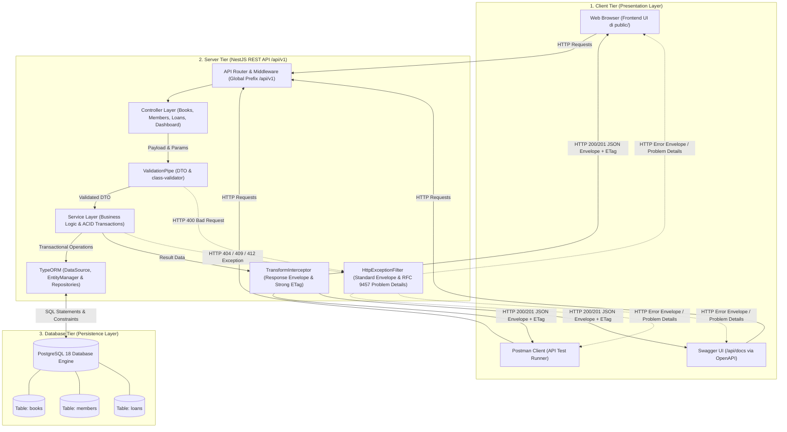

# Perancangan Sistem Informasi Perpustakaan Sederhana (REST API)

Dokumen ini memuat **Pemetaan 7 Tugas Mata Kuliah**, **Arsitektur Client-Server**, **Product Requirements Document (PRD)**, **Entity-Relationship Diagram (ERD)**, dan **Kontrak Endpoint RESTful API (/api/v1)**.

---

## 1. Pemetaan 7 Tugas Mata Kuliah REST API

| No. Tugas | Topik & Sasaran Perkuliahan | Komponen Implementasi Proyek | Status |
|---|---|---|---|
| **Tugas 1** | Requirement Analysis, API Design & Contract | Dokumen PRD, ERD, Arsitektur Client-Server, API Contract, status code, & data dictionary | Selesai (Tahap 1) |
| **Tugas 2** | Project Scaffolding, Architecture & Configuration | NestJS 12+, TypeScript, modular pattern, `.env.example`, Global Pipes/Filters | Selesai (Tahap 1) |
| **Tugas 3** | Database Modeling, TypeORM & Migrations | PostgreSQL entity schema, migrations, constraints (unique NIM, positive stock) | Selesai (Tahap 2) |
| **Tugas 4** | Resource CRUD & Validation (Books & Members) | Controller, Service, DTO dengan `class-validator`, UUID v4, pagination/filtering, Strong ETag, RFC 9457 | Selesai (Tahap 2) |
| **Tugas 5** | Transactional Business Logic (Loans & Returns) | Transaksi database ACID (`DataSource.transaction`), validasi stok buku, due date, status | Selesai (Tahap 2) |
| **Tugas 6** | API Documentation & Postman Artifacts | OpenAPI/Swagger (`/api/docs`), Postman Collection JSON v2.1, OpenAPI JSON & YAML | Selesai (Tahap 2) |
| **Tugas 7** | Automated Testing & Consumer Interface | Unit Test (Vitest 40 tests), E2E Test (Vitest 33 tests), Newman (48 assertions), Frontend Web (HTML5/CSS3/JS) | Selesai (Tahap 2) |

---

## 2. Arsitektur Client-Server

Sistem Informasi Perpustakaan Sederhana ini dibangun dengan mengimplementasikan prinsip arsitektur **Client-Server bertingkat tiga (Three-Tier Architecture)** yang memisahkan secara tegas dan modular antara lapisan antarmuka pengguna (*presentation layer*), lapisan logika aplikasi/pemrosesan (*application/business logic layer*), dan lapisan penyimpanan data persisten (*data persistence layer*).

Pemisahan ini memastikan sistem bersifat *loosely coupled*, mempermudah pemeliharaan perangkat lunak, mendukung skalabilitas, serta memenuhi standar rancangan RESTful API modern.



---

### 2.1 Deskripsi Komponen Arsitektur Berdasarkan Source Code Aktual

Sesuai dengan implementasi nyata pada repositori, rincian komponen pada masing-masing tingkatan adalah sebagai berikut:

#### 1. Client Tier (Lapisan Konsumen / Presentasi)
Lapisan client bertindak sebagai konsumen layanan (*API consumer*) yang berinteraksi dengan backend melalui protokol HTTP/HTTPS tanpa memiliki akses langsung ke basis data:
- **Frontend Web Mandiri (`public/`)**: Dibangun secara statis dan ringan tanpa framework berat, menggunakan standar HTML5 (`index.html`), CSS modern (`css/style.css`), dan JavaScript murni (*vanilla ES6+* di `js/app.js`). Berfungsi sebagai antarmuka pustakawan lokal untuk menampilkan ringkasan metrik dashboard, mengelola data buku dan anggota, serta memproses sirkulasi peminjaman/pengembalian buku melalui pemanggilan asinkronus `Fetch API`.
- **Postman Client**: Digunakan untuk pengujian fungsional manual dan otomatisasi regresi melalui *Postman Collection v2.1* (`postman/perpus_uts_api.postman_collection.json`). Bertindak sebagai klien HTTP yang mengevaluasi kepatuhan status code, skema payload, header *Strong ETag*, mekanisme *conditional request* (`If-Match`), dan format galat RFC 9457.
- **Swagger UI (`/api/docs`)**: Konsol dokumentasi interaktif yang dihasilkan secara otomatis oleh `@nestjs/swagger` berdasarkan anotasi OpenAPI pada controller dan DTO. Memungkinkan pengembang menguji langsung setiap endpoint dari browser.

#### 2. Server Tier (Lapisan Backend & Logika Bisnis NestJS)
Backend diimplementasikan menggunakan **NestJS** berbasis **TypeScript** yang berjalan di atas lingkungan Node.js, dengan arsitektur modular yang terstruktur:
- **Global Prefix `/api/v1`**: Seluruh endpoint RESTful dipetakan di bawah namespace `/api/v1` untuk menjamin versioning rute yang terstandarisasi.
- **Controller Layer (`*.controller.ts`)**: Menerima request HTTP masuk, mendefinisikan rute (`@Get`, `@Post`, `@Put`, `@Patch`, `@Delete`), mengekstraksi parameter rute (`@Param`), kueri URL (`@Query`), data body (`@Body`), dan headers (`@Headers`), serta mendelegasikan pemrosesan ke service.
- **Data Transfer Object (DTO) & ValidationPipe**: Memvalidasi setiap data input menggunakan `ValidationPipe` global dengan konfigurasi keamanan `whitelist: true`, `forbidNonWhitelisted: true`, dan `transform: true`. Setiap properti pada DTO divalidasi menggunakan decorator dari `class-validator` (misalnya `@IsString()`, `@IsInt()`, `@Min()`, `@IsOptional()`). Masukan yang tidak valid langsung ditolak dengan status HTTP 400 Bad Request sebelum dieksekusi oleh service.
- **Service Layer (`*.service.ts`)**: Pusat logika bisnis (*business logic layer*). Menangani kalkulasi stok, aturan keunikan NIM anggota, pencegahan pengembalian ganda, serta penguncian transaksi atomik (*ACID transactions*) menggunakan `DataSource.transaction` dan `pessimistic_write` (*SELECT FOR UPDATE*) untuk mencegah kondisi balapan (*race condition*).
- **Transform Interceptor (`TransformInterceptor`)**: Interceptor global yang mencegat output dari controller untuk membungkus respons ke dalam amplop standar (*standard response envelope*): `{ statusCode, success: true, message, data, meta }`, serta menghitung dan menyematkan header *Strong ETag* (RFC 9110) berbasis *hash* SHA-1.
- **Global Exception Filter (`HttpExceptionFilter`)**: Mencegat setiap eksepsi yang terjadi di dalam aplikasi. Jika client menyertakan header `Accept: application/problem+json`, filter akan merespons dengan format RFC 9457 *Problem Details* (`type`, `title`, `status`, `detail`, `instance`). Untuk client standar, filter mengembalikan amplop galat JSON yang konsisten.

#### 3. Database Tier (Lapisan Persistensi Data)
- **PostgreSQL 18 Engine**: Basis data relasional yang bertindak sebagai satu-satunya *single source of truth* untuk seluruh data persisten sistem pada database `perpus_uts_db` (dan `perpus_uts_test_db` untuk lingkungan pengujian).
- **TypeORM Data Mapper**: Lapisan abstraksi basis data yang mengelola koneksi (*DataSource*), pemetaan relasi entitas (`Book`, `Member`, `Loan`), skrip migrasi terstruktur (`src/database/migrations/`), serta penegakan integritas data pada tingkat DBMS melalui *foreign keys* (`ON DELETE RESTRICT`), *unique index* (NIM), dan *check constraints* (eksemplar non-negatif).

---

### 2.2 Alur Pemrosesan Siklus Hidup Request-Response (Lifecycle Flow)

Siklus pemrosesan sebuah HTTP request dari saat dikirim oleh client hingga respons JSON diterima kembali berlangsung secara deterministik melalui tahapan berikut:

```
[ HTTP Client: Web UI / Postman / Swagger UI ]
                      │
                      │ 1. Mengirim HTTP Request (misal: POST /api/v1/loans)
                      ▼
            [ NestJS Routing Layer ]
                      │
                      │ 2. Mencocokkan rute ke Controller yang bersesuaian
                      ▼
           [ LoansController (@Post) ]
                      │
                      │ 3. Meneruskan data masukan ke pipeline validasi
                      ▼
        [ Global ValidationPipe (DTO) ]
                      │
       ┌──────────────┴──────────────┐
       │ (Jika Valid)                │ (Jika Tidak Valid / Galat Sintaks)
       ▼                             ▼
[ LoansService ]             [ HttpExceptionFilter ]
       │                             │
       │ 4. Menjalankan logika bisnis│ 4b. Mengembalikan HTTP 400 Bad Request
       │    dan transaksi ACID       │     (JSON Envelope / Problem Details)
       ▼                             │
[ TypeORM EntityManager ]            │
       │                             │
       │ 5. Mengeksekusi query SQL   │
       ▼                             │
[ PostgreSQL Database Engine ]       │
       │                             │
       │ 6. Memproses data di tabel  │
       │    (books, members, loans)  │
       ▼                             │
[ TypeORM Entity Mapping ]           │
       │                             │
       │ 7. Mengonversi baris tabel  │
       │    menjadi TypeScript entity│
       ▼                             │
[ LoansController Return Value ]     │
       │                             │
       │ 8. Mengirim data hasil ke   │
       │    interceptor              │
       ▼                             │
[ TransformInterceptor ]             │
       │                             │
       │ 9. Membungkus ke amplop     │
       │    standar & menyematkan    │
       │    Strong ETag header       │
       ▼                             ▼
[ HTTP Response JSON (200 / 201) ]   [ HTTP Error Response (4xx / 5xx) ]
       │                                     │
       └──────────────────┬──────────────────┘
                          │ 10. Mengirimkan HTTP Response kembali ke Client
                          ▼
[ HTTP Client: Web UI / Postman / Swagger UI ]
```

---

### 2.3 Pemisahan Tanggung Jawab (Separation of Concerns)

Penerapan prinsip *Separation of Concerns* (SoC) pada proyek ini membagi batasan tanggung jawab secara tegas:

1. **Tanggung Jawab Client (Presentation Layer)**:
   - Menyajikan antarmuka visual (UI) yang responsif dan mudah dipahami oleh petugas perpustakaan.
   - Menangani interaksi pengguna (*user events* seperti input formulir, klik tombol tambah/hapus buku, dan filter pencarian).
   - Mengonversi data formulir menjadi format JSON standar sebelum mengirimkan request ke backend.
   - Mengonsumsi respons JSON dan memperbarui tampilan *Document Object Model* (DOM) secara dinamis tanpa me-refresh seluruh halaman.
   - Menampilkan notifikasi visual atas keberhasilan transaksi maupun pesan galat dari backend.
   - *Batasan:* Client bersifat murni *stateless presentation*; client tidak memiliki hak akses langsung ke basis data, tidak menyimpan data utama secara lokal, dan tidak menentukan aturan validasi bisnis final.

2. **Tanggung Jawab Server (Application & Business Logic Layer)**:
   - Menyediakan antarmuka komunikasi formal melalui kontrak RESTful API `/api/v1`.
   - Mengisolasi dan memvalidasi keabsahan struktur serta tipe data request body melalui skema DTO.
   - Menegakkan seluruh aturan integritas bisnis (*business invariants*), seperti memastikan stok buku mencukupi sebelum dipinjam, mencegah pengembalian buku yang telah berstatus `RETURNED`, dan mendeteksi konflik konkurensi data melalui evaluasi *Strong ETag* dan header `If-Match`.
   - Mengoordinasikan transaksi multi-tabel secara atomik (ACID) agar kegagalan parsial tidak menyebabkan inkonsistensi stok buku.
   - Menyeragamkan format amplop respons HTTP, header keamanan, serta penanganan galat terstandarisasi.
   - *Batasan:* Server tidak menyimpan status sesi (*stateless* sesuai prinsip REST) dan tidak bergantung pada implementasi antarmuka klien tertentu.

3. **Tanggung Jawab Database (Data Persistence & Storage Layer)**:
   - Menyimpan seluruh rekaman data buku, anggota, dan transaksi sirkulasi secara permanen pada disk fisik.
   - Menjamin integritas referensial antar-relasi melalui *Foreign Key Constraints* dengan opsi `ON DELETE RESTRICT` (mencegah penghapusan buku/anggota yang memiliki keterikatan transaksi).
   - Menerapkan batasan nilai (*Check Constraints*) pada level DBMS, seperti memastikan `availableCopies >= 0`, `totalCopies >= 1`, dan `availableCopies <= totalCopies`.
   - Menegakkan keunikan identitas data melalui *Unique Constraint* pada kolom NIM anggota.
   - Menyediakan mekanisme penguncian baris data (*pessimistic row-level locking*) untuk memastikan isolasi transaksi saat eksekusi kueri bersamaan.
   - *Batasan:* Basis data tidak mencampuri logika presentasi antarmuka maupun aturan serialisasi format transfer data HTTP; basis data sepenuhnya fokus pada persistensi, keandalan, dan efisiensi kueri data.

---

## 3. Product Requirements Document (PRD)

### 3.1 Latar Belakang & Tujuan
Sistem Informasi Perpustakaan Sederhana ini dibangun untuk kebutuhan demonstrasi operasional pustakawan lokal:
- Mengelola katalog buku (judul, penulis, ISBN opsional, total eksemplar, eksemplar tersedia).
- Mengelola data anggota perpustakaan (nama, NIM unik, email opsional).
- Menangani siklus peminjaman buku: peminjaman (mengurangi stok tersedia, menetapkan tanggal jatuh tempo) dan pengembalian (menambah stok tersedia, mencatat tanggal kembali).
- Menyediakan dashboard ringkasan metrik koleksi dan sirkulasi.
- Menolak redundansi dan inkonsistensi data dengan validasi DTO ketat dan database constraints.

### 3.2 Batasan Sistem (Scope Boundary)
- Khusus internal demonstrasi pustakawan (tanpa otentikasi login pengguna umum/role guard kompleks).
- Tanpa modul denda keterlambatan uang, pembayaran, atau barcode scanner.
- Standar RESTful seragam di bawah prefix `/api/v1`.
- Skema response terstandarisasi:
  ```json
  {
    "statusCode": 200,
    "success": true,
    "message": "Operasi berhasil",
    "data": { ... },
    "meta": { ... } // opsional untuk pagination
  }
  ```

---

## 4. Entity-Relationship Diagram (ERD)

```
+--------------------------------------------------------+
|                         BOOK                           |
+--------------------------------------------------------+
| id: UUID (PK)                                          |
| title: VARCHAR(255) NOT NULL                           |
| author: VARCHAR(255) NOT NULL                          |
| isbn: VARCHAR(50) NULL                                 |
| totalCopies: INTEGER (>= 1)                            |
| availableCopies: INTEGER (>= 0 AND <= totalCopies)     |
| createdAt: TIMESTAMP                                   |
| updatedAt: TIMESTAMP                                   |
+--------------------------------------------------------+
                        | 1
                        |
                        | N
+--------------------------------------------------------+
|                         LOAN                           |
+--------------------------------------------------------+
| id: UUID (PK)                                          |
| bookId: UUID (FK -> books.id)                          |
| memberId: UUID (FK -> members.id)                      |
| loanDate: DATE NOT NULL                                |
| dueDate: DATE NOT NULL                                 |
| returnDate: DATE NULL                                  |
| status: VARCHAR(20) CHECK ('BORROWED', 'RETURNED')     |
| notes: TEXT NULL                                       |
| createdAt: TIMESTAMP                                   |
| updatedAt: TIMESTAMP                                   |
+--------------------------------------------------------+
                        | N
                        |
                        | 1
+--------------------------------------------------------+
|                        MEMBER                          |
+--------------------------------------------------------+
| id: UUID (PK)                                          |
| name: VARCHAR(255) NOT NULL                            |
| nim: VARCHAR(50) NOT NULL UNIQUE                       |
| email: VARCHAR(255) NULL                               |
| createdAt: TIMESTAMP                                   |
| updatedAt: TIMESTAMP                                   |
+--------------------------------------------------------+
```

### 4.1 Integritas & Batasan (Database Constraints)
1. **Buku (`books`)**:
   - `totalCopies >= 1` (Check Constraint: `chk_books_total_copies`)
   - `availableCopies >= 0 AND availableCopies <= totalCopies` (Check Constraint: `chk_books_available_copies`)
2. **Anggota (`members`)**:
   - `nim` bersifat `UNIQUE` (Unique Constraint: `uq_members_nim`)
3. **Peminjaman (`loans`)**:
   - Foreign key `bookId` merujuk ke `books(id)` dengan `ON DELETE RESTRICT` (mencegah penghapusan buku yang sedang memiliki riwayat peminjaman aktif).
   - Foreign key `memberId` merujuk ke `members(id)` dengan `ON DELETE RESTRICT`.
   - `status IN ('BORROWED', 'RETURNED')` (Check Constraint: `chk_loans_status`).
   - `dueDate >= loanDate` (Check Constraint: `chk_loans_due_date`).

---

## 5. Kontrak Endpoint RESTful API (`/api/v1`)

### 5.1 Dashboard
- `GET /api/v1/dashboard/summary`
  Mengambil statistik ringkasan perpustakaan (total judul buku, total eksemplar fisik, eksemplar tersedia, total anggota, total peminjaman aktif).

### 5.2 Resource: Books (`/api/v1/books`)
- `GET /api/v1/books`
  Daftar semua buku (query: `search`, `page`, `limit`, `sortBy`, `order`). Menghasilkan header `ETag` (Strong ETag).
- `GET /api/v1/books/:id`
  Detail satu buku berdasarkan UUID. Menghasilkan header `ETag`.
- `POST /api/v1/books`
  Tambah buku baru. Body: `{ "title": string, "author": string, "isbn"?: string, "totalCopies": number }`. (Otomatis `availableCopies = totalCopies`).
- `PUT /api/v1/books/:id`
  Perbarui seluruh data buku. Mendukung evaluasi `If-Match` dengan `pessimistic_write` lock; melempar HTTP 412 jika ETag tidak cocok.
- `PATCH /api/v1/books/:id`
  Perbarui sebagian data buku. Mendukung evaluasi `If-Match`.
- `DELETE /api/v1/books/:id`
  Hapus buku (ditolak jika memiliki transaksi peminjaman aktif).

### 5.3 Resource: Members (`/api/v1/members`)
- `GET /api/v1/members`
  Daftar semua anggota (query: `search`, `page`, `limit`, `sortBy`, `order`). Menghasilkan header `ETag`.
- `GET /api/v1/members/:id`
  Detail anggota beserta riwayat peminjamannya. Menghasilkan header `ETag`.
- `POST /api/v1/members`
  Pendaftaran anggota baru. Body: `{ "name": string, "nim": string, "email"?: string }`. Menolak duplikasi NIM dengan HTTP 409 Conflict.
- `PUT /api/v1/members/:id`
  Perbarui data anggota. Mendukung evaluasi `If-Match`.
- `PATCH /api/v1/members/:id`
  Perbarui sebagian data anggota. Mendukung evaluasi `If-Match`.
- `DELETE /api/v1/members/:id`
  Hapus data anggota (ditolak jika sedang meminjam buku).

### 5.4 Resource: Loans (`/api/v1/loans`)
- `GET /api/v1/loans`
  Daftar riwayat peminjaman (filter: `status = BORROWED | RETURNED`, `memberId`, `bookId`, `page`, `limit`, `sortBy`, `order`).
- `GET /api/v1/loans/:id`
  Detail transaksi peminjaman dengan relasi book & member.
- `POST /api/v1/loans`
  Peminjaman buku baru (Atomic Transaction via `DataSource.transaction`):
  - Validasi keberadaan member & book.
  - Validasi stok buku: `availableCopies > 0`. Jika 0, lemparkan `400 Bad Request: Stok buku habis`.
  - Kurangi `availableCopies = availableCopies - 1`.
  - Buat baris data `loans` dengan status `BORROWED`, `loanDate = today`, `dueDate = loanDate + 7 hari` (jika tidak ditentukan).
- `PATCH /api/v1/loans/:id/return`
  Pengembalian buku (Atomic Transaction via `DataSource.transaction`):
  - Cek apakah loan berstatus `BORROWED`. Jika sudah `RETURNED`, lemparkan `400 Bad Request: Buku sudah dikembalikan`.
  - Update `status = RETURNED`, `returnDate = today`.
  - Tambah `availableCopies = availableCopies + 1` pada tabel `books`.
